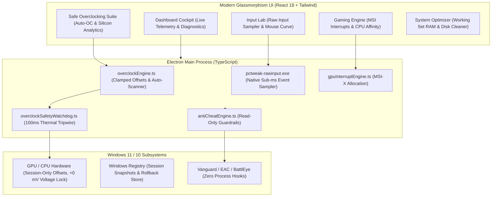

<div align="center">

# PC Tweak

**Modern Windows PC Optimization, Hardware Telemetry & Non-Destructive Tweaking Cockpit**

[](package.json)
[](https://microsoft.com/windows)
[](tests/)
[](https://www.electronjs.org/)
[](https://react.dev/)
[](https://www.typescriptlang.org/)
[](LICENSE)

<br />

*Engineered with a strict Zero-Harm Hardware Safety Architecture, zero fake telemetry, and zero-game-process intervention for esports and competitive gaming.*

</div>

---

## Architecture Overview



---

## Core Features

### 1. Zero-Harm Safe Overclocking & Silicon Analytics
* **Zero Overvolting:** Voltage adjustment is strictly hard-locked at factory stock (+0 mV). Silicon degrades from excessive voltage, not from frequency adjustments under stock voltage.
* **Boot-Loop Immunity:** Offsets operate purely in active memory at the driver level during the active Windows session. Zero writes to vBIOS, BIOS, or NVRAM. Any reboot boots 100% at factory stock defaults.
* **100ms Thermal Tripwire:** Active background watchdog checks temperatures every 100ms. If GPU core temp exceeds 80°C, hotspot exceeds 92°C, or CPU exceeds 85°C, clocks immediately drop to factory defaults in under 100ms.
* **Safe Clamping Limits:**
  * GPU Core Clock: Clamped to `[-50, +120 MHz]`
  * GPU Memory Clock: Clamped to `[0, +350 MHz]`
  * Power Target: Clamped to `[100%, 105%]`
* **1-Click Auto-OC Scanner:** Guided step-wise scanner testing pre-flight thermal checks, memory bandwidth scaling (+25 MHz steps), and compute stability (+15 MHz steps).
* **Silicon Stability & Headroom Analytics:** Live thermal headroom margin to 80°C, Silicon Stability Index (`Grade A+`), estimated FPS gain, and memory bandwidth delta (+GB/s).

### 2. High-Precision Input Lab & Native Raw Input
* **Native C++ Raw Input Sampler (`pctweak-rawinput.exe`):** Measures true hardware mouse polling rate, packet arrival variance, and dropped frames.
* **Windows SPI Scaling:** Accurate mathematical mapping across all 11 mouse pointer speed notches with enhanced pointer precision toggling.
* **DirectX & Presentation Optimizations:** Max frame latency configuration, modern DXGI flip model upgrade, and elevated shader cache buffers.

### 3. System Optimizer & Working Set RAM Trimmer
* **Working Set RAM Compaction:** Non-destructive working set memory compaction without process killing.
* **Safe Junk Cleaner:** Removal of temporary clutter, crash dumps, and DirectX shader caches.
* **Service & Task Auditor:** Identifies orphaned services and telemetry updaters with safe toggling and rollback.
* **Esports CPU Affinity & MSI Interrupts:** Dedicated Message Signaled Interrupts (MSI-X) allocation and CPU thread isolation.

### 4. Anti-Cheat Safety Guardrails
* **Zero Process Injection:** PC Tweak operates with strict zero-game-process intervention (no handle injection, no code hooking, no kernel drivers).
* **Compliance Checks:** Read-only system state inspection for Secure Boot, TPM 2.0, HVCI/VBS, and official verification for Riot Vanguard, Easy Anti-Cheat, and BattlEye.

---

## Safety Comparison

| Feature | Standard OC Utilities | PC Tweak Safe Overclocking |
| :--- | :--- | :--- |
| **Core Voltage** | Uncapped (+100 mV risk) | **Hard-locked at +0 mV** |
| **Boot-Loop Protection** | Registry / Startup service risk | **100% In-Memory Session Only** |
| **Thermal Protection** | Passive vendor throttling (88°C+) | **Active 100ms Tripwire (< 80°C)** |
| **Clock Limits** | Unlimited | **Clamped (+120 Core / +350 Mem)** |
| **Pre-flight Check** | None | **Aborts scan if GPU > 55°C** |
| **Instant Rollback** | Manual reset | **1-Click Factory Stock Restore** |

---

## Tech Stack

| Component | Technology |
| :--- | :--- |
| **Shell & Runtime** | Electron 33, Node.js 20 |
| **Frontend UI** | React 18, TypeScript, Tailwind CSS, Lucide Icons |
| **State Management** | Zustand (0ms instant tab switching with preserved DOM state) |
| **Low-Level Native** | C++ Win32 Raw Input API (`RegisterRawInputDevices`) |
| **Telemetry & WMI** | CIM Win32_VideoController, NVML (`nvidia-smi` non-blocking async) |
| **Localization** | i18next (English & Persian) |
| **Test Suite** | Native Node.js Test Runner (`node:test`, 380+ tests) |
| **Packaging** | electron-builder (NSIS Installer & Portable x64) |

---

## Getting Started

### Prerequisites
* Windows 10 (Build 19041+) or Windows 11 (22H2 / 23H2 / 24H2)
* Node.js 20+

### Installation & Development
```bash
# Clone the repository
git clone https://github.com/AdamBarfii/PC-Tweak.git
cd PC-Tweak

# Install dependencies
npm install

# Start development server
npm run dev
```

### Running Automated Tests
```bash
# Run all 380 unit and integration tests
node --test (Get-ChildItem tests/*.test.mjs).FullName

# Verify telemetry integrity (Zero hardcoded mock strings)
node --test tests/telemetryIntegrity.test.mjs

# Run TypeScript typecheck
npx tsc --noEmit
```

### Building Production Binaries
```bash
# Build frontend and electron bundle
npm run build

# Package unpacked 64-bit app
npx electron-builder --dir --x64

# Package NSIS Windows Setup Installer
npx electron-builder --win nsis --x64
```
The installer will be generated at `release/PC Tweak Setup 1.0.0.exe`.

---

## Deploy to Program Files
To deploy the compiled application to `C:\Program Files\PC Tweak`:
1. Run `npm run build` and `npx electron-builder --dir --x64`.
2. Double-click `Deploy PC Tweak.bat` on your desktop (automatically self-elevates and deploys files).

---

## Security & Anti-Cheat Disclosure
Please review our [SECURITY.md](SECURITY.md) for detailed policies on anti-cheat compliance, memory safety, and vulnerability disclosure.

---

## Contributing
Contributions are welcome! Please read [CONTRIBUTING.md](CONTRIBUTING.md) for details on code style, automated testing requirements, and submission processes.

---

## License
Distributed under the MIT License. See [LICENSE](LICENSE) for more information.
