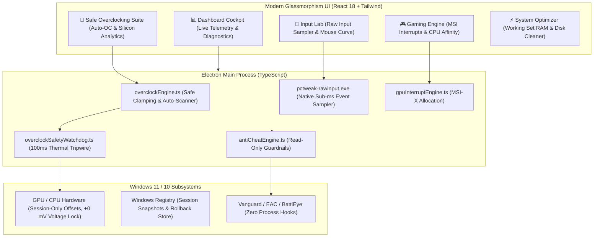

<div align="center">

```ascii
  ██████╗   ██████╗     ████████╗ ██╗    ██╗ ███████╗  █████╗  ██╗  ██╗
  ██╔══██╗ ██╔════╝     ╚══██╔══╝ ██║    ██║ ██╔════╝ ██╔══██╗ ██║ ██╔╝
  ██████╔╝ ██║             ██║    ██║ █╗ ██║ █████╗   ███████║ █████╔╝ 
  ██╔═══╝  ██║             ██║    ██║███╗██║ ██╔══╝   ██╔══██║ ██╔═██╗ 
  ██║      ╚██████╗        ██║    ╚███╔███╔╝ ███████╗ ██║  ██║ ██║  ██╗
  ╚═╝       ╚═════╝        ╚═╝     ╚══╝╚══╝  ╚══════╝ ╚═╝  ╚═╝ ╚═╝  ╚═╝
              ⚡ Optimize. Tweak. Overclock. Play Better. ⚡
```

### 🚀 Next-Generation Windows Gaming & Performance Telemetry Cockpit

[](https://github.com/AdamBarfii/PC-Tweak/releases)
[](https://github.com/AdamBarfii/PC-Tweak/releases/download/v1.0.0/PC.Tweak.Setup.1.0.0.exe)
[](https://microsoft.com/windows)
[](tests/)
[](SECURITY.md)
[](LICENSE)

<br />

[📦 **Download Installer (v1.0.0)**](https://github.com/AdamBarfii/PC-Tweak/releases/download/v1.0.0/PC.Tweak.Setup.1.0.0.exe) • [✨ **Features**](#-core-features) • [🛡️ **Safety Guardrails**](#-zero-harm-hardware-safety-architecture) • [📊 **Architecture**](#-architecture-blueprint) • [⚙️ **Development**](#-quick-start--development)

</div>

---

## ⚡ What is PC Tweak?

**PC Tweak** is an open-source, non-destructive Windows optimization and hardware telemetry application engineered specifically for competitive gaming, esports low-latency response, and safe hardware performance tuning.

Unlike conventional tweaking utilities that modify dangerous vBIOS settings or tamper with game processes, PC Tweak operates with **Zero Fake Telemetry**, **Zero Game-Process Hooks**, and a **Strict Zero-Harm Hardware Safety Architecture**.

---

## 💎 Core Features

```
┌────────────────────────────────────────────────────────────────────────────────────────┐
│  🧊 Zero-Harm Safe Auto-OC        🎯 Native C++ Raw Input Lab    ⚡ Non-Destructive RAM Trim │
│  🛡️ Anti-Cheat Read-Only Guard   🎮 Esports CPU Core Topology   📊 Real Telemetry Cockpit  │
└────────────────────────────────────────────────────────────────────────────────────────┘
```

### 🧊 1. Zero-Harm Safe Overclocking & Silicon Analytics
* 🔒 **Zero Overvolting (Voltage Locked at +0 mV):** Core and memory voltages are strictly locked at factory defaults. Modern silicon is degraded by excessive voltage, not by clock frequencies under stock voltage.
* 🛡️ **Boot-Loop Immunity:** Offsets operate purely in active memory at the driver level. No modifications are written to vBIOS, BIOS, or NVRAM. Any system reboot automatically restores 100% factory defaults.
* ⏱️ **100ms Thermal Tripwire:** Background safety watchdog checks temperatures every 100ms. If GPU core temp exceeds **80°C**, hotspot exceeds **92°C**, or CPU exceeds **85°C**, clocks immediately drop to factory stock in under 100ms.
* 🎛️ **Safe Clamping Envelopes:**
  * GPU Core Clock: `[-50, +120 MHz]`
  * GPU Memory Clock: `[0, +350 MHz]`
  * Power Target: `[100%, 105%]`
* 🧪 **1-Click Auto-OC Step Scanner:** Guided testing with pre-flight check (aborts if GPU > 55°C), memory bandwidth verification (+25 MHz steps), and compute stability verification (+15 MHz steps).
* 📊 **Silicon Stability & Headroom Analytics:** Live thermal headroom margin to 80°C, Silicon Stability Index (`Grade A+`), estimated FPS gains, and memory bandwidth delta (+GB/s).

---

### 🎯 2. High-Precision Input Lab & Native Raw Input
* 🏎️ **Native C++ Raw Input Sampler (`pctweak-rawinput.exe`):** Direct Win32 Raw Input API measurements recording real packet arrival times, polling frequency, and variance without Windows message queue lag.
* 🖱️ **Mathematical SPI Scaling:** Faithful mapping across all 11 Windows pointer speed notches with enhanced pointer precision toggling.
* 🖥️ **DirectX Low-Latency Presentation:** 1-frame max frame latency clamping, modern DXGI flip model upgrade, and expanded shader cache allocations.

---

### ⚡ 3. System Optimizer & Working Set RAM Trimmer
* 🧹 **Working Set RAM Compaction:** Instant physical memory reclamation using Windows working set trimming without killing background processes.
* 🗑️ **Safe Junk Cleaner:** Clean removal of temporary clutter, crash dumps, and stale DirectX shader caches.
* 🔍 **Orphaned Service & Task Auditor:** Identifies broken or orphaned registry services and scheduled maintenance updaters with safe rollback backups.

---

### 🛡️ 4. Anti-Cheat Safety Guardrails
* 🚫 **Zero Process Intervention:** No handle injection (`PROCESS_ALL_ACCESS`), no code hooking, no DLL injection, no kernel drivers.
* 🎮 **Verified Compatibility:** Clean read-only diagnostics for:
  * **Riot Vanguard** (Valorant, League of Legends)
  * **Easy Anti-Cheat / EOS** (Fortnite, Apex Legends, Rust, The Finals)
  * **BattlEye** (Rainbow Six Siege, Destiny 2, PUBG, DayZ)
* 🔐 **Security Integrity Checks:** Read-only inspection of Windows Secure Boot, TPM 2.0, and HVCI / VBS status.

---

## 📊 Feature Comparison Matrix

| Capability | Generic "FPS Booster" Tools | Standard OC Utilities | ⚡ PC Tweak |
| :--- | :---: | :---: | :---: |
| **GPU Voltage Modification** | ⚠️ Risky Scripts | ❌ Uncapped (+100 mV) | 🔒 **Locked at +0 mV (Zero Degradation)** |
| **Boot-Loop Recovery** | ❌ None (Requires Safe Mode) | ❌ Registry / vBIOS Risk | ✅ **100% In-Memory Session Only** |
| **Active Thermal Protection** | ❌ None | ⚠️ Passive Throttling (88°C+) | ⏱️ **Active 100ms Tripwire (< 80°C)** |
| **Hardware Offset Clamping** | ❌ None | ❌ Unlimited | 🛡️ **Clamped (+120 Core / +350 Mem)** |
| **Telemetry Authenticity** | ⚠️ Often Fake / Simulated | ⚠️ Heavy Polling | 📊 **Real Subsystem Telemetry (Zero Slop)** |
| **Anti-Cheat Safe** | ❌ Process Injection Risk | ⚠️ Hook Warnings | 🛡️ **100% Non-Invasive (Zero Hooks)** |
| **Automated Tests** | ❌ None | ❌ Untested | 🧪 **380 Automated Unit Tests** |

---

## 🏛️ Architecture Blueprint



---

## 📦 Tech Stack

* **Shell & Desktop Runtime:** [Electron 33](https://www.electronjs.org/) + [Node.js 20](https://nodejs.org/)
* **Frontend UI Framework:** [React 18](https://react.dev/), [TypeScript 5.5](https://www.typescriptlang.org/), [Tailwind CSS 3.4](https://tailwindcss.com/)
* **Icons & Visual Language:** [Lucide React](https://lucide.dev/), Custom Cyberpunk Glassmorphism
* **State Management:** [Zustand](https://github.com/pmndrs/zustand) (Instant 0ms tab switching with DOM state preservation)
* **Native Subsystem:** C++ Win32 Raw Input API (`RegisterRawInputDevices`)
* **Hardware Telemetry:** CIM `Win32_VideoController`, NVML (`nvidia-smi` non-blocking async)
* **Bilingual Localization:** English & Persian (`fa`) via `i18next`
* **Test Harness:** Native Node.js test runner (`node:test`, 380+ passing tests)
* **Packaging & Distribution:** [electron-builder 25](https://www.electron.build/) (NSIS Installer & x64 Binaries)

---

## ⚙️ Quick Start & Development

### 📋 Prerequisites
* Windows 10 (Build 19041+) or Windows 11 (22H2 / 23H2 / 24H2)
* Node.js 20+

### 🛠️ Setup
```bash
# 1. Clone the repository
git clone https://github.com/AdamBarfii/PC-Tweak.git
cd PC-Tweak

# 2. Install dependencies
npm install

# 3. Launch in development mode
npm run dev
```

### 🧪 Run Automated Tests
```bash
# Run all 380 unit and integration tests
node --test (Get-ChildItem tests/*.test.mjs).FullName

# Verify telemetry integrity (Strict Zero-Mock-Hardware rule)
node --test tests/telemetryIntegrity.test.mjs

# Run TypeScript type check
npx tsc --noEmit
```

### 🏗️ Build Production Binaries
```bash
# Compile frontend and Electron bundles
npm run build

# Package unpacked 64-bit app to release/win-unpacked
npx electron-builder --dir --x64

# Package NSIS Windows Setup Installer
npx electron-builder --win nsis --x64
```

---

## 📥 Download & Installation

The latest release installer is compiled and available for immediate download:

* 💾 **Direct Installer Download:** [PC Tweak Setup 1.0.0.exe](https://github.com/AdamBarfii/PC-Tweak/releases/download/v1.0.0/PC.Tweak.Setup.1.0.0.exe)
* 🏷️ **GitHub Release Tag:** [v1.0.0 Release Notes](https://github.com/AdamBarfii/PC-Tweak/releases/tag/v1.0.0)

---

## 🔒 Security & Anti-Cheat Disclosure
Please review our [SECURITY.md](SECURITY.md) for detailed policies on anti-cheat compliance, memory safety boundaries, and responsible vulnerability disclosure.

---

## 🤝 Contributing
Contributions, issue reports, and feature suggestions are welcome! Please see [CONTRIBUTING.md](CONTRIBUTING.md) for coding conventions, test coverage guidelines, and pull request procedures.

---

## 📄 License
This project is licensed under the MIT License. See [LICENSE](LICENSE) for full details.
